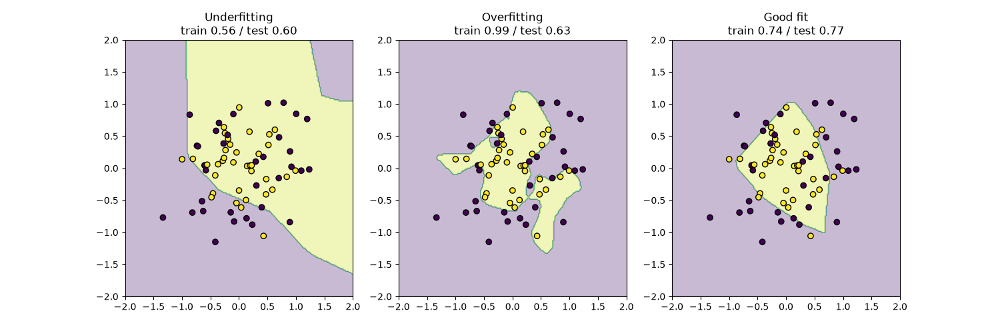

# Neural Network: Underfitting vs Overfitting

A small neural network built with scikit-learn that learns to separate two rings of dots. I used it to see what underfitting, overfitting and a good fit actually look like.

## What I learned
- **Underfitting:** the network is too simple, like a student who didn't study enough. It scores low on both training and test data.
- **Overfitting:** the network is too big and memorizes the noisy training dots, like a student who memorized the practice exam. It scores 100% in training but much lower on new data.
- **Good fit:** a smaller network with a light penalty (alpha) learns the actual shape, so the training and test scores stay close.

## How to run
pip install scikit-learn matplotlib
python charts.py